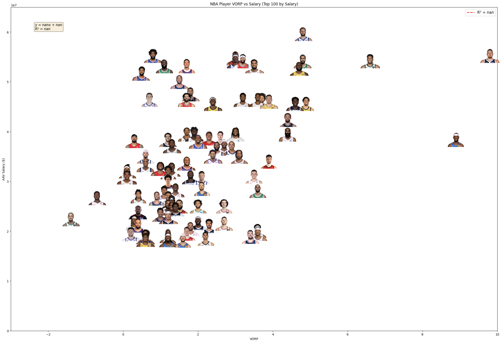

# NBA Salary vs. Performance Analysis

A Python project exploring the relationship between NBA player salaries and on-court performance during the 2024–25 season.

## Project Overview

I collected NBA salary data from Spotrac and advanced player statistics from Basketball Reference. I cleaned player names, merged the datasets, and analyzed salary versus Value Over Replacement Player (VORP) for the top 100 highest-paid players in the collected salary data.

## Technologies Used

- Python
- pandas
- Requests and BeautifulSoup
- Matplotlib
- SciPy
- nba_api

## What I Did

- Scraped salary and advanced player statistics from online sources.
- Cleaned and standardized player names to match records across datasets.
- Removed duplicate player records and merged the datasets using pandas.
- Created a scatterplot using NBA player headshots to visualize salary versus VORP.
- Applied linear regression and calculated R-squared to examine the relationship.

## Data Sources

- Spotrac — NBA salary rankings
- Basketball Reference — 2024–25 advanced player statistics
- NBA API — player IDs and headshot images

## Visualization

